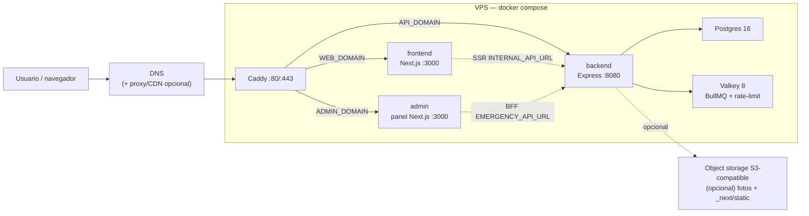

# Arquitectura actual

Este documento describe cómo funciona el sistema hoy. Es una plantilla: no
asume ningún país, evento u organización — la identidad de cada despliegue
(nombre, dominios, centro del mapa, contacto) vive en
`config/deployment.config.json` y en variables de entorno (`.env.example`),
nunca en código.

**Dos topologías de despliegue soportan el mismo código de aplicación**, sin
fork del repo — ver `CLAUDE.md` → "Dos caminos de despliegue" para cuál
elegir y `## Despliegue` más abajo para el detalle técnico de cada una:

| | Camino A — Cloudflare Workers (primario) | Camino B — VPS (alternativo) |
| --- | --- | --- |
| Runtime backend/frontend/admin | Workers (`@opennextjs/cloudflare`, `httpServerHandler`) | Node, `docker-compose.prod.yml` |
| Driver de Postgres | Neon HTTP (sin conexión con estado) | node-postgres (`pg`, pool TCP) |
| Transacciones interactivas | No soportadas | Soportadas |
| Jobs de fondo | Cloudflare Queues + Cron Triggers | BullMQ + Valkey |
| Reverse proxy / TLS | Cloudflare (borde) | Caddy (en el propio VPS) |

## Resumen

El proyecto es un monorepo con tres servicios de aplicación y una capa de
infraestructura compartida:

- `frontend/`: Next.js + React. Renderiza la UI, sirve assets y llama al
  backend por una URL absoluta (`NEXT_PUBLIC_API_URL`).
- `backend/`: Express + TypeScript. Sirve toda la superficie `/api`, valida
  entorno al arrancar, accede a Postgres con Drizzle y comparte imagen con el
  worker y el job de migraciones.
- `backend/worker/`: BullMQ sobre Valkey para sync de fuentes externas,
  geocode, deduplicación, federación de hub y backfills/migraciones.
- `admin/`: panel de administración como microservicio Next.js standalone
  (3er tier, RBAC con JWT en cookie httpOnly). Su BFF (`app/api/*`) reenvía al
  backend por la red interna del despliegue.
- `infra/db/`: esquema Drizzle y migraciones SQL.
- `docker-compose.prod.yml` + `Caddyfile.example`: despliegue de producción
  en un **único VPS** (docker compose + Caddy como reverse proxy/TLS). Ver
  [Despliegue](#despliegue).

## Flujo de requests

Un único **Caddy** en el VPS termina TLS y enruta por hostname a los
contenedores; el navegador llama a la API por `NEXT_PUBLIC_API_URL`
(`https://${API_DOMAIN}`) y los server components por `INTERNAL_API_URL`
(`http://backend:8080`) dentro de la red del compose.

El frontend no accede directo a la base de datos. En cliente usa
`frontend/lib/api.ts`; en server components usa `frontend/lib/server-api.ts`.
Las fotos pueden venir como rutas relativas desde la API y se anclan al
backend con `mediaUrl()`.

## Frontend

- Next corre en modo `output: "standalone"` desde `frontend/`.
- `NEXT_PUBLIC_*` se inlinea en build; los cambios de esas variables requieren
  rebuild/redeploy del frontend.
- TanStack Query maneja cache, deduplicación y polling del cliente.
- Cloudflare Turnstile se monta con `useTurnstile()` en formularios públicos y
  entrega tokens de un solo uso al backend (opcional: sin `TURNSTILE_SECRET_KEY`
  se desactiva en desarrollo).
- `NEXT_PUBLIC_ASSET_PREFIX` puede apuntar a un CDN/object storage para
  `/_next/static` si despliegas más de una réplica del frontend.

## Backend API

- Express monta los routers en `backend/src/routes/` y delega lógica a
  `backend/src/services/`.
- `backend/src/config/env.ts` valida entorno de forma fail-fast.
- La API escucha en `:8080` y expone dos health checks: `/api/healthz`
  (liveness, sin I/O) y `/api/readyz` (readiness, chequea la DB con `select 1`
  y timeout corto → 503 si no responde).
- CORS usa allowlist (`CORS_ORIGINS`), porque el frontend y la API son
  dominios separados.
- Las mutaciones públicas combinan Zod, rate-limit y `requireHuman`
  (Cloudflare Turnstile, opcional). Las rutas admin legadas usan
  `ADMIN_PASSWORD`/headers existentes.
- Lecturas polleadas usan cache en proceso y ETag cuando el contrato lo
  permite.
- `GET /api/reports` pagina el conjunto completo para que mapa y
  administración no pierdan reportes antiguos al superar 500 registros.
- APIs de terceros se consumen vía PROXY del backend (nunca desde el
  navegador), para controlar cache/contrato y no depender del CORS del
  tercero. Caso simple: `/api/geocode` proxea Nominatim (`services/geocode.ts`).
- **API keys (integraciones).** La superficie `api/public/*` se autentica con
  JWT (cookie/Bearer) O con una **API key** (`Authorization: Bearer
  mer_sk_…`). El middleware (`middleware/auth.ts`) detecta el prefijo, busca
  el hash SHA-256 en `api_keys` (índice único → O(1)), valida que no esté
  revocada/expirada y cuelga el mismo `req.user` que el JWT — así
  `requireCapability` no cambia. Las llaves son **self-service**: cualquier
  usuario invitado (capacidad `apikey:manage`, sembrada en todos los roles)
  crea/lista/revoca las suyas en el panel; el admin semilla puede revocar
  ajenas. Cada llave lleva **scopes** (subconjunto de capacidades): el
  permiso efectivo en cada request = `scopes ∩ capacidades vivas del usuario`
  — un techo least-privilege que aplica **incluso al admin semilla** (ver el
  corte en `auth/resolve.ts`). La llave cruda se muestra una sola vez; en DB
  solo va su hash + un prefijo no secreto. Revocar = soft-delete
  (`revokedAt`).

## Integraciones de terceros (flags `ENABLE_*`)

Toda integración externa opcional (directorio de acopio, federación de hub,
OCR de pacientes, fuente de sync de ejemplo) se activa con su propio flag en
`.env.example` — `ENABLE_RESPONSEGRID`, `ENABLE_HUB_FEDERATION`,
`ENABLE_PATIENT_OCR`, `ENABLE_EXAMPLE_SOURCE` — todas en `false` por defecto.
El template debe arrancar y funcionar completo sin ninguna integración
configurada; cada una degrada con gracia (endpoint 503, feature deshabilitada)
cuando falta su configuración. Ver [`docs/modules.md`](modules.md) para el
registro completo: qué hace cada módulo, su superficie de vendor/compliance,
sus variables requeridas, y el walkthrough del adaptador de ejemplo como
patrón para agregar una fuente de datos real.

### Módulos de integración (DDD/hexagonal)

Las integraciones con terceros viven como **bounded contexts** en
`backend/src/modules/<dominio>/`, con capas separadas y dependencias hacia
adentro (la infraestructura depende del dominio, no al revés):

- `domain/`: entidades + value objects + reglas puras y el **puerto**
  (interfaz) que define la fuente. Sin HTTP, sin red, sin `env`.
- `application/`: casos de uso que orquestan el dominio sobre el puerto.
- `infrastructure/`: adaptadores que implementan el puerto (cliente HTTP,
  mapper anti-corruption) y decoradores transversales (p.ej. cache).
- `interface/http/`: router + controlador + presenter (única capa que conoce
  Express). El `@swagger` vive aquí; `lib/swagger.ts` escanea `modules/**`.
- `<dominio>-module.ts`: composition root; el único sitio que lee `env` y
  cablea adaptador → puerto → caso de uso → router.

Primer módulo: **acopio** (`modules/acopio/`, gateado por
`ENABLE_RESPONSEGRID`), que proxea el directorio de centros de acopio de
ResponseGrid (config en `RESPONSEGRID_API_URL` / `RESPONSEGRID_EMERGENCY_SLUG`).
Añadir otra fuente = otro adaptador del mismo puerto, cableado en el
composition root; el dominio y la capa HTTP no cambian. Las reglas ESLint de
endpoints (`require-rate-limit`, guard de mutaciones) también cubren
`src/modules/**`.

Segundo módulo: **needs** (`modules/needs/`), lado de ESCRITURA: publica una
necesidad de insumos en ResponseGrid vía `POST /api/needs` (mutación pública
con Turnstile + rate-limit). La API devuelve `202` con un identificador
consultable en `GET /api/needs/status/{jobId}`; el worker BullMQ geocodifica
la dirección con un puerto `Geocoder` (adaptador sobre `services/geocode` →
Nominatim) y delega en el puerto `NeedPublisher`, con reintentos e
idempotencia opcional mediante `Idempotency-Key`. La escritura autentica con
la **api-key** de service account (`x-api-key`, `RESPONSEGRID_API_KEY`) y
envía un campo opcional **`author`** (contacto del solicitante, `verified:
false` fijado por el servidor) para atribuir la necesidad sin que la persona
se registre en ResponseGrid. Sin api-key, se cablea un publisher
deshabilitado y el endpoint responde 503. A diferencia del resto de routes,
este endpoint **no lleva bloque `@swagger`** a propósito: es un proxy de
escritura con credencial de servicio y no publicamos su contrato en
`/api/docs` como superficie de abuso (la protección efectiva sigue siendo
Turnstile + rate-limit).

## Datos y migraciones

### Qué driver de Postgres usar — árbol de decisión

`backend/src/db/index.ts` elige el driver según el runtime, no según una
variable que configures a mano:

- **¿Corre en un proceso Node normal** (docker compose, el worker BullMQ,
  o cualquier cosa fuera de un isolate de Workers)**?** → node-postgres
  (`pg`), con pool TCP con estado. Soporta transacciones interactivas.
- **¿Corre dentro de un isolate de Cloudflare Workers** (Camino A —
  frontend/backend/admin desplegados como Worker)**?** → el driver HTTP de
  Neon, sin conexión con estado. **No** soporta transacciones interactivas.

Esto no es una preferencia de configuración — es una restricción
arquitectónica de la plataforma: en un Worker, un socket TCP pertenece a la
petición que lo abrió y no sobrevive entre invocaciones del isolate, así que
un pool con estado (node-postgres) simplemente no funciona ahí. Intentar
"arreglarlo" con más reintentos o un pool más chico no cambia esto — solo un
driver sin estado (HTTP) funciona sobre Workers, y ese driver trae su propia
limitación (sin transacciones interactivas — ver AGENTS.md → "PROHIBIDO
`db.transaction`" para los patrones de reemplazo). Inyectar una cadena de
conexión de pooling local (p.ej. Hyperdrive) en el lugar de una URL HTTP de
Neon real rompe casi cualquier consulta — no es un atajo válido.

- Postgres es la base de datos de producción, co-ubicada en el mismo VPS por
  defecto (servicio `db` de `docker-compose.prod.yml`) o externa si prefieres.
- Drizzle vive en `infra/db/schema.ts`; las migraciones versionadas viven en
  `infra/db/migrations/`.
- Las bajas de personas importadas crean una supresión por `legacy_id` y,
  cuando existe, por `(source, external_id)`. El sync externo consulta esas
  supresiones para que una eliminación administrativa sea permanente; las
  fotos propias se eliminan del object storage antes de borrar la fila.
- El servicio `migrate` de `docker-compose.prod.yml` usa la imagen backend y
  corre antes de que arranquen `backend`/`worker`. Si falla, la app no rota.
- Las migraciones deben ser expand-contract si vas a hacer rollouts sin
  downtime (contenedores viejos siguen sirviendo mientras el nuevo arranca
  contra el esquema actualizado).
- **Réplica pública (hub SQL, opcional, `ENABLE_HUB_FEDERATION`).** Un
  segundo Postgres de solo lectura puede recibir por **replicación lógica**
  solo las tablas/columnas publicables (sin PII directa de secretos/
  auditoría/federación) y exponer SQL crudo de solo lectura por TCP con TLS,
  para que otro despliegue hermano del mismo template pueda leer datos
  agregados. El acceso lo emite el backend: un **super admin**
  (`mirror:manage`, gateada por `users.is_super_admin`) crea un rol Postgres
  por consumidor. Si el hub cae, el primario no se afecta
  (`max_slot_wal_keep_size` acota el WAL). Esta réplica es independiente de la
  automatización de firewall específica de un proveedor cloud, que queda
  fuera de esta plantilla (ver "Fuera de esta plantilla" más abajo).

## Fotos y object storage

- Sin object storage configurado, las fotos se sirven directo desde el
  backend (`R2_*` vacío en `.env.example`). Con R2 (u otro S3-compatible)
  configurado, las fotos se rehostean ahí y se sirven vía `R2_PUBLIC_BASE`
  (o el dominio propio que le adjuntes, p.ej. `cdn.example.org`) — ambos
  caminos coexisten en el mismo código: el path activo depende solo de si
  las variables `R2_*` están presentes.
- **Las Cache Rules de zona de Cloudflare son un no-op para un Worker en un
  dominio propio.** Un Worker desplegado en un dominio personalizado
  (custom domain) se ejecuta **antes** de la fase de cache de la zona — las
  reglas de cache configuradas en el dashboard/OpenTofu de Cloudflare para
  ese dominio nunca llegan a aplicarse a las respuestas del Worker, aunque
  la configuración se vea correcta y no dé ningún error. Si necesitas cache
  de borde para fotos servidas por un Worker (Camino A), impleméntala
  **dentro** del propio Worker con la API `caches.default`, no confiando en
  una regla de cache de zona.
- Al agregar cache de borde delante de un endpoint que refleja el `Origin`
  de la petición en `Access-Control-Allow-Origin` (con `Vary: Origin`),
  normaliza qué se cachea por origen — un cache de borde que ignora `Vary`
  puede servirle a un cliente de un origen distinto las cabeceras CORS de
  otro cliente.

## Workers y colas

- Valkey respalda BullMQ y el rate-limit distribuido.
- El servicio `migrate` de `docker-compose.prod.yml` usa la misma imagen
  backend con otro `command`.
- Los schedulers de sync/hub están gateados por sus flags
  (`ENABLE_EXAMPLE_SOURCE`, `ENABLE_HUB_FEDERATION`) además de
  `SYNC_SCHEDULERS`/`HUB_SCHEDULERS`; ambos apagados por defecto.
- El worker sigue disponible para jobs manuales como migración de fotos a
  object storage y trabajos encolados explícitamente.
- La cola `patient-imports` procesa la importación autenticada de pacientes
  hospitalarios (solo si `ENABLE_PATIENT_OCR` o el flujo manual de importación
  están en uso): la API `POST /api/public/patient-imports` (capacidad
  `patient:import`) guarda el lote en staging (`patient_imports` +
  `patient_import_rows`) y encola; el worker normaliza, valida y deduplica
  las filas, y `POST .../{id}/apply` encola la escritura idempotente en
  `hospital_patients` (solo filas válidas y únicas). El dato crudo y los
  campos sensibles (documento, notas, contacto) viven en staging restringido
  y no se exponen en las respuestas públicas. La deduplicación por hash de
  documento es global entre hospitales. Los refugios comparten este modelo
  con `hospitals.facility_type = refugio` y sus personas usan
  `hospital_patients.status = sheltered`. La entrada OCR/ICR por imagen se
  habilita solo si existe un proveedor de visión (VL) configurado; materializa
  filas en staging como `needs_review` y nunca auto-aplica. Sin proveedor, o
  para PDF, responde 501.
- **Sismos** (`earthquakes.queue.ts`): el worker poll-ea un feed público de
  sismos (por defecto el feed realtime del USGS, global) cada
  `EARTHQUAKES_EVERY_MS` (default 60s), filtra al bounding box configurado
  (`EARTHQUAKES_MIN_LAT`/`MAX_LAT`/`MIN_LNG`/`MAX_LNG` — las 4 son
  obligatorias, fail-fast si falta alguna; no hay bbox global por defecto)
  y hace upsert por id de evento en la tabla `earthquakes`. Al
  arrancar, si la tabla está vacía, encola un backfill puntual (últimos
  `EARTHQUAKES_BACKFILL_DAYS` días, una sola llamada). Este scheduler
  **siempre corre** (no va bajo `SYNC_SCHEDULERS`): es dato público y barato.
  El backfill de arranque es idempotente (solo si la tabla está vacía), así
  que el primer deploy siembra solo. La superficie pública es `GET
  /api/earthquakes` (read-only, anónima, cacheada con ETag).

### Camino A: el mismo seam de jobs sobre Cron Triggers + Cloudflare Queues

`backend/worker/**` (BullMQ) no puede correr dentro de un Worker de
Cloudflare — no hay proceso de larga duración ni conexión sostenida a Redis.
El Camino A reemplaza cada pieza con su equivalente serverless, sin cambiar
la firma pública de ningún job:

- **Productor**: `backend/src/lib/job-dispatch.ts` elige transporte por lo
  que esté realmente registrado — un binding de Queues si existe,
  `VALKEY_URL` si no — nunca asume uno sobre el otro.
- **Consumidor**: `backend/src/lib/queue-consumer.ts`, cableado en el
  handler `queue` de `backend/src/worker.ts`. Ack por mensaje; cartas
  muertas persistidas en `audit_log`.
- **Sismos y geocode**: pasan de scheduler-en-proceso a **Cron Triggers**
  (`backend/src/services/cron-jobs.ts`), con cadencias separadas/offset
  entre sí para no competir por la misma ventana.
- **Publicación de necesidades e importación de pacientes**: pasan a
  **Cloudflare Queues** con DLQ dedicada.

Ver AGENTS.md → "Jobs de fondo" para el contrato completo (límite de
mensaje, creación de colas antes del primer deploy, por qué `queues` no se
hereda en `env.staging`).

## Despliegue

Dos topologías soportadas sobre el mismo código — ver `CLAUDE.md` → "Dos
caminos de despliegue" para cuál elegir.

### Camino A — Cloudflare Workers (primario)

Runbook operativo completo, fase por fase:
[`docs/runbook-cloudflare-launch.md`](runbook-cloudflare-launch.md).

- `frontend/`, `backend/` y `admin/` se despliegan cada uno como su propio
  Worker de Cloudflare, vía `@opennextjs/cloudflare` (frontend/admin,
  Next.js) y `httpServerHandler` de `cloudflare:node` (backend — envuelve la
  app de Express **sin reescribirla**).
- Cada paquete trae su propio `wrangler.jsonc` con `compatibility_flags:
  ["nodejs_compat"]`, alias de esbuild para módulos fuera del paquete
  (`infra/db/schema.ts`) o que no corren en Workers tal cual
  (`swagger-ui-express` — ver `backend/src/shims/`), y **nunca** un bloque
  `routes` (ver `CLAUDE.md` → "Conocimiento operativo" para por qué).
- Base de datos: Neon Postgres externo, driver HTTP (ver "Qué driver de
  Postgres usar" arriba).
- Secretos: Doppler, no `.env` — ver `docs/doppler.md`.
- Jobs de fondo: Cron Triggers + Cloudflare Queues (ver arriba).
- Zona de Cloudflare (DNS, anti-suplantación, WAF, cache, rate limit):
  módulo OpenTofu opcional en `infra/cloudflare/`.

**Base de conocimiento de compatibilidad con Workers**, para cualquier
código nuevo que vaya a correr ahí (no solo el ya escrito):

- `backend/src/config/env.ts` valida entorno fail-fast con
  `process.exit(1)` — eso es un no-op en un Worker. Un fallo de validación
  en Workers no produce el mensaje claro que produce en Node; produce un
  `TypeError` genérico más adelante. Código de validación que deba correr en
  ambos runtimes necesita una salida de fallo que funcione en Workers
  (lanzar, no `process.exit`).
- Nunca leas variables de entorno en scope de módulo en código alcanzable
  desde `backend/src/worker.ts` — ver AGENTS.md → "Convenciones de
  implementación" para el porqué exacto y el patrón correcto.
- Cualquier dependencia que asuma APIs de Node no shimmeadas por
  `nodejs_compat` (acceso a filesystem, `process.cpuUsage()`,
  `fileURLToPath(import.meta.url)` sin verificar, etc.) puede tumbar **cada
  ruta** del Worker al desplegar, no solo la que la usa — pasa
  desapercibido en local (Node completo) y solo se ve en producción. Revisa
  `backend/src/shims/` antes de asumir que una librería nueva necesita un
  shim propio; puede que ya exista uno.
- Un `next build` exitoso en local **no** prueba que una ruta funcione en el
  Worker desplegado — cualquier I/O de filesystem o Node-only dentro de una
  route (p.ej. leer un asset desde `public/` con `node:fs` en tiempo de
  request) puede pasar el prerender local (que sí corre sobre Node, con
  `public/` en disco) y devolver 500 en producción, donde solo el bundle
  viaja al borde.

### Camino B — VPS (alternativo)

Runbook paso a paso (provisión, hardening, DNS, TLS, smoke checks, backups,
actualización y rollback): [`docs/deploy-vps.md`](deploy-vps.md). Es el
único camino donde corre **todo** el sistema sin adaptación: colas BullMQ,
transacciones interactivas de Postgres, y el panel `admin/`.

- El stack lo define `docker-compose.prod.yml` detrás de `Caddyfile.example`
  (un único Caddy que reverse-proxea a `frontend:3000`, `backend:8080`,
  `admin:3000` por hostname, leyendo `WEB_DOMAIN`/`API_DOMAIN`/`ADMIN_DOMAIN`/
  `ACME_EMAIL` del entorno vía placeholders `{$VAR}`).
- Postgres y Valkey van co-ubicados en el mismo VPS por defecto (servicios
  `db`/`valkey`); las migraciones corren como el contenedor `migrate`
  one-off, gateado antes de que arranquen `backend`/`worker`.
- Un object storage compatible con S3 (p.ej. Cloudflare R2) es opcional para
  fotos y, con `NEXT_PUBLIC_ASSET_PREFIX`, los assets estáticos de Next.
- Cómo desplegar (push-to-deploy, CI/CD, un script manual sobre SSH) queda a
  criterio de quien opere el despliegue; esta plantilla no incluye un
  workflow de CI/CD por defecto para este camino (el Camino A sí trae
  workflows de GitHub Actions — ver `.github/workflows/deploy-*.yml`).

### Fuera de esta plantilla (futuro trabajo)

Un modelo de orquestación multi-nodo (Kubernetes/k3s + OpenTofu/Terraform)
con Load Balancers separados por servicio, autoscaling y una nube específica
(p.ej. Hetzner Cloud) es un camino alterno razonable para despliegues de
mayor escala, pero no forma parte de esta plantilla. Si lo necesitas:

- Recupera el modelo de tres Deployments (`web`, `api`, `admin`) con su
  Service/LoadBalancer y HPA, reutilizando la imagen backend para worker y el
  job de migraciones — el mismo patrón que ya describe este documento para
  docker compose se traslada 1:1 a manifiestos de Kubernetes.
  Los Ingress/servicios que hoy resuelve `Caddyfile.example` por hostname
  pasarían a Ingress rules, y las credenciales de proveedor cloud (API
  tokens, kubeconfig) irían en el gestor de secretos de tu CI, no en
  `.env.example`.
- La automatización de firewall por API de un proveedor cloud específico
  (para abrir/cerrar acceso de un consumidor a la réplica del hub) es
  opcional y también queda fuera de esta plantilla; sin ella, la réplica del
  hub simplemente no gestiona firewall automáticamente.

## Al cambiar arquitectura

Cada cambio que modifique esta forma del sistema debe actualizar:

- `docs/architecture.md` para reflejar el estado nuevo.
- `AGENTS.md` cuando cambien reglas que los agentes deben seguir.
- `.env.example` si cambia el contrato de entorno (grupo correcto, marca
  `[REQ]`/`[OPT]`, placeholder obviamente falso).
- `docker-compose.yml` / `docker-compose.prod.yml` / `Caddyfile.example` si
  cambia un servicio, puerto o dominio (Camino B).
- `frontend/wrangler.jsonc` / `backend/wrangler.jsonc` / `admin/wrangler.jsonc`,
  `*/open-next.config.ts`, y `.github/workflows/deploy-*.yml` si cambia un
  binding, var, flag de compatibilidad, alias de bundling o smoke check
  (Camino A). El módulo OpenTofu de `infra/cloudflare/` si cambia DNS, WAF,
  cache o rate limit de la zona.
